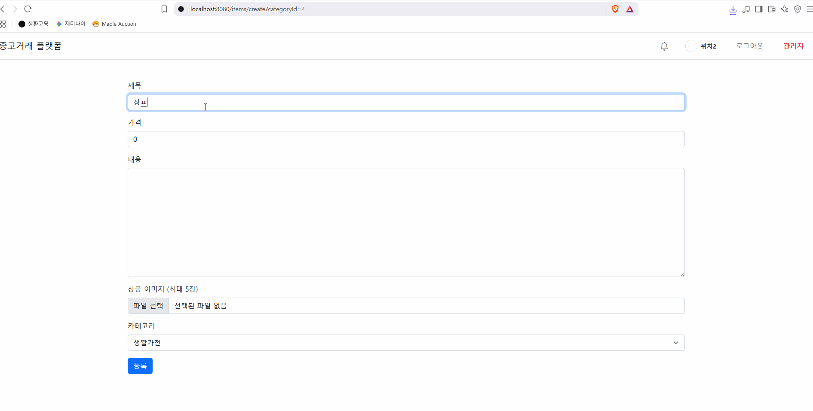
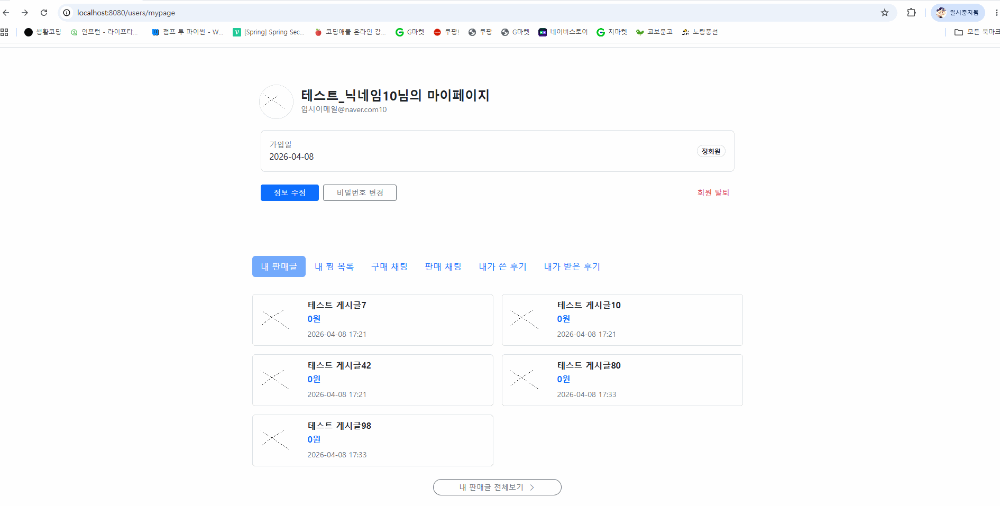
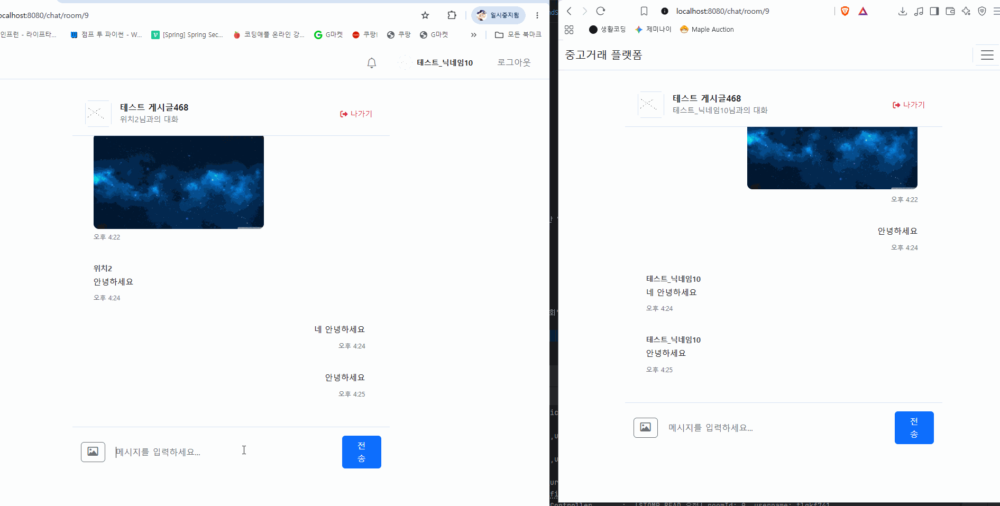
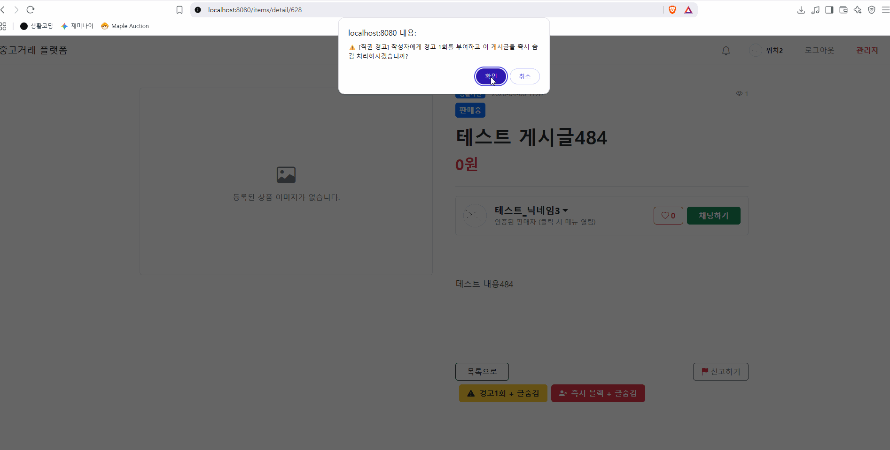

# 🛒 중고거래 플랫폼 (Market Project)

Spring Boot와 Thymeleaf 기반으로 제작한 중고거래 및 실시간 알림 웹 애플리케이션입니다.

---

## 🛠️ 사용 기술 스택 (Tech Stack)

### Backend
- **Java 17 / Spring Boot 3.x**
- **Spring Data JPA**
- **Spring Security & OAuth2 Client** (Google, Naver)
- **SSE (Server-Sent Events)** (실시간 알림 구현)

### Database & Security
- **MySQL 8.0**
- **Spring Mail (SMTP)**

### Frontend
- **Thymeleaf**
- **Bootstrap 5**
- **JavaScript (ES6+)**

---

## ✨ 핵심 기능

1. **회원 관리 & OAuth2 소셜 로그인**
    - 일반 회원가입 및 로그인 / 네이버, 구글 소셜 로그인 연동
    - 이메일 인증 기능

2. **상품 관리 및 거래**
    - 상품 등록, 수정, 삭제 및 상태 변경 (판매중 / 예약중 / 판매완료)
    - 카테고리별 상품 목록 조회

3. **실시간 SSE 알림 시스템**
    - 채팅 수신 및 주요 상태 변경 시 **Server-Sent Events** 기반 실시간 알림 발송
    - 읽지 않은 알림 개수 실시간 배지 표시 및 읽음 처리

4. **채팅 시스템**
    - 구매자와 판매자 간 1:1 채팅방 생성 및 메시지 주고받기

